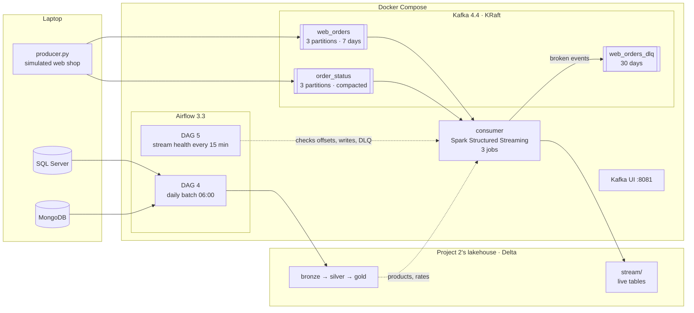
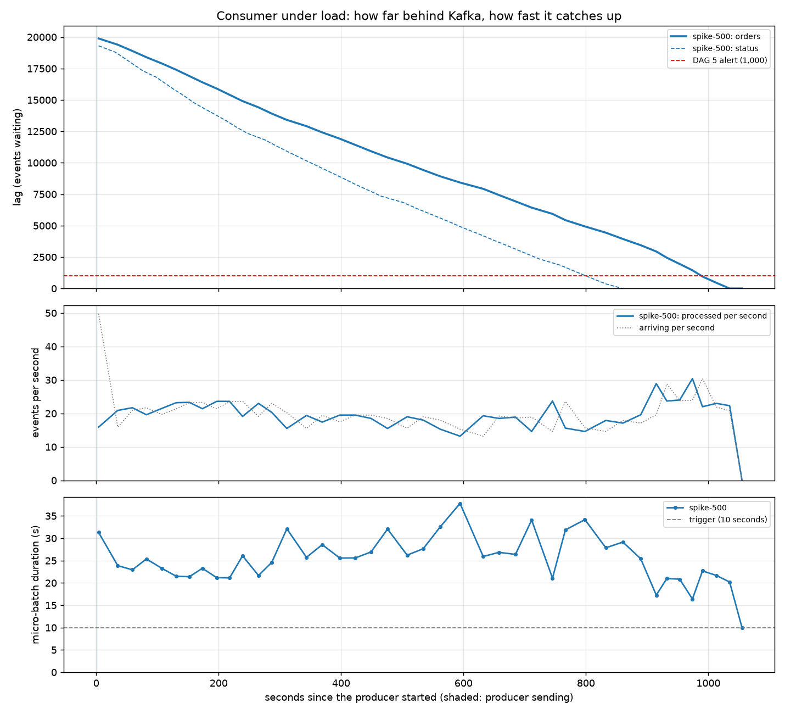
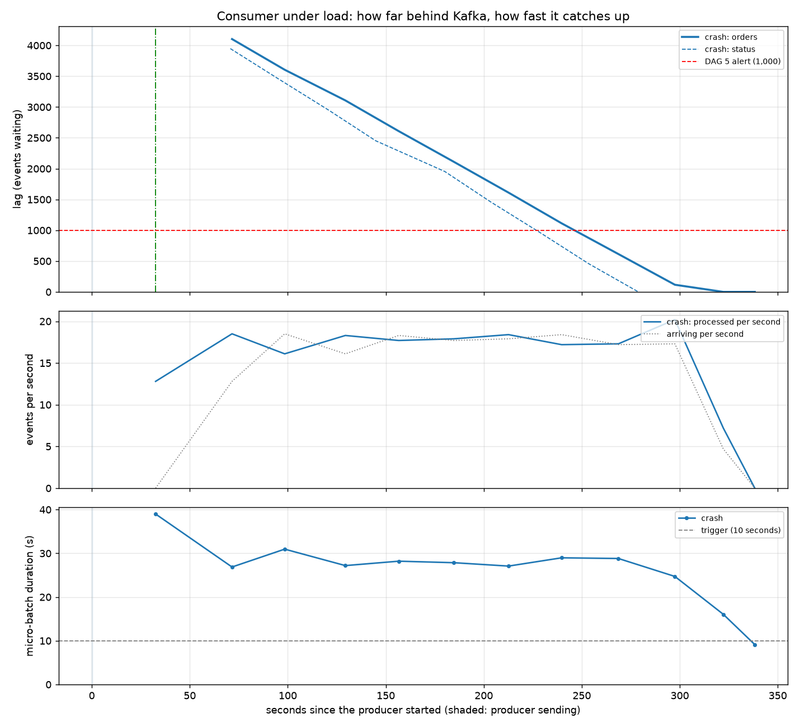

# Lusitânia Stores — Orchestration and Streaming with Airflow, Kafka and Spark

The same retail business as [Project 1](https://github.com/JNFernandes/lusitania-bi-data-warehouse) and [Project 2](https://github.com/JNFernandes/lusitania-lakehouse), now run like production:

- **Part A, orchestration:** Apache Airflow runs Project 2's batch lakehouse (bronze → silver → gold) every morning, with retries, timeouts and alerts.
- **Part B, streaming:** web-shop orders flow through Apache Kafka into live Delta tables within seconds, with Spark Structured Streaming. Airflow watches the stream's health.

It all runs locally in Docker, at no cost, and reuses Project 2's code: Airflow and the consumer import the same `lusitania` package. Four experiments (spike, crash, tombstone, schema change) test the pipeline under failure, with measured results and graphs.

<p>
  
  
  
  
  
  
</p>

---

## Architecture



| Service | Image | Role |
|---|---|---|
| `airflow-apiserver` (`:8080`), `airflow-scheduler`, `airflow-dag-processor` | `lusitania-airflow:3.3.2` (own image: official Airflow + Java + a separate pipeline venv with Spark, Delta, dbt) | runs the DAGs, LocalExecutor |
| `postgres` | `postgres:16` | Airflow's metadata database |
| `kafka` (`:9092`) | `apache/kafka:4.4.0` | one broker in KRaft mode (no ZooKeeper) |
| `kafka-init` | `apache/kafka:4.4.0` | creates the three topics, then exits (topic auto-creation is off) |
| `kafka-ui` (`:8081`) | `kafbat/kafka-ui` | browse topics, messages, headers, consumer offsets |
| `consumer` | same image as Airflow | the streaming job: never finishes, so it is a service, not an Airflow task |

Project 2's folder is mounted into the containers (`../LusitaniaLakehouse:/opt/lakehouse`), so they run its code and write to its Delta tables. The containers reach SQL Server and MongoDB on the laptop through `host.docker.internal`, with a read-only SQL login.

---

## Part A — Orchestration with Airflow

Airflow doesn't move data itself. It decides **order, timing and what happens on failure**, and calls code that already exists.

| DAG | Schedule | What it teaches |
|---|---|---|
| `01_hello_airflow` | 06:00 | tasks, parallel branches, passing values between tasks (XCom) |
| `02_retries_and_failures` | manual | retries for a flaky API; a failing task stops what depends on it |
| `03_check_connections` | manual | can the containers reach SQL Server, MongoDB, the API, Spark and dbt? |
| **`04_lusitania_pipeline`** | **06:00 Lisbon** | **the real batch pipeline of Project 2** |
| **`05_stream_health`** | **every 15 min** | **monitors the streaming consumer (Part B)** |

**DAG 4:**

```
check_sources ─► load_bronze ─► build_silver ─► dbt_snapshot ─► dbt_run ─► dbt_test ─► report_gold
```

- **Retries only where they help.** `check_sources` and `load_bronze` get 2 retries, 5 minutes apart, because a source that's restarting usually comes back. The silver and dbt steps get none: bad data or a failed test gives the same result every time, so retrying only delays the alert.
- `max_active_runs=1`, because two runs would write the same Delta tables and the same DuckDB file.
- Every task has an `execution_timeout`, and the run has a `dagrun_timeout`. A failed task calls `alert_on_failure`.
- `dbt_snapshot` runs before `dbt_run`, so the dimensions are built on fresh SCD2 history. `dbt_test` runs Project 2's 50 dbt tests on the result.

**DAG 5** checks the stream from outside, using two sources that are always right: the consumer's **checkpoint** (what it has processed) and **Kafka's offsets** (what exists). Its three checks run in parallel:

| Check | Fails when |
|---|---|
| `check_lag` | more than 1,000 events are waiting: the consumer can't keep up |
| `check_consumer_alive` | events are waiting but nothing was written for 5 minutes: stuck or down |
| `check_dlq` | in the last 15 minutes, more than 10 broken events **and** more than 5% of orders: bad data upstream |

"Behind" and "dead" are separate alerts because they need different fixes. The DLQ check needs both conditions, so the normal background of broken events doesn't page anyone.

---

## Part B — Streaming with Kafka and Spark

### The producer

`streaming/producer.py` simulates the web shop. It sends orders in the **same JSON format as the MongoDB documents**, so the consumer can reuse Project 2's silver cleaning. On purpose, it also sends the problems a real stream has:

| Problem | Share | What the consumer must do |
|---|---|---|
| late orders (2–25 minutes old) | 10% | include them in the live table; leave the ones beyond the watermark out of the final totals |
| duplicates (the same order sent again) | 2% | keep it once |
| broken events (bad JSON, no date, unknown SKU, unknown schema version) | 1% | send to the dead letter queue, never crash |
| status changes paid → shipped → delivered | per order | keep only the latest status per order |

The producer is idempotent (`enable.idempotence`, `acks=all`), so a network retry can't write an event twice. Every event carries **headers** (`event-type`, `source`, `schema-version`). Orders use the order number as the **key**, so all events of one order go to the same partition, in order.

### The consumer: three jobs in one Spark session

| Job | Reads | Writes | Key techniques |
|---|---|---|---|
| **1 · orders** | `web_orders` | `online_orders_live` (Delta) + `web_orders_dlq` (Kafka) | Project 2's `parse()` / `explode_lines()` / `to_eur()`; `dropDuplicatesWithinWatermark`; stream–static join with the silver products and rates; `foreachBatch` for several outputs |
| **2 · totals** | `online_orders_live` (as a stream) | `sales_per_5_minutes` | event-time 5-minute windows, 10-minute watermark, append mode: a window is written once, when it's final |
| **3 · status** | `order_status` | `order_status_current` | latest event per order, Delta `MERGE`; a tombstone deletes the row |

**Exactly-once:** Spark's checkpoint says which offsets each micro-batch covers. The Delta write carries `txnAppId` + `txnVersion` = the batch number, so a batch redone after a crash is recognised and skipped. The DLQ is at-least-once, and its headers (`original-partition`, `original-offset`) let a reader drop repeats.

**Backpressure:** `maxOffsetsPerTrigger = 500` caps each micro-batch, so a spike becomes a queue instead of an out-of-memory crash.

**Dead letter queue:** a broken event goes to `web_orders_dlq` **unchanged**. The reason and its origin go in the headers: `error-reason`, `original-topic`, `original-partition`, `original-offset`. The event can be inspected or replayed later.

**Performance records:** a `StreamingQueryListener` appends every micro-batch's progress (events, rate, duration, lag) to `data/stream/_metrics/`. `streaming/perf_report.py` turns those records into the graphs below.

---

## Experiments

Each experiment was run on a laptop (2 Spark cores, Docker Desktop on Windows) and measured with `perf_report.py` and `look_stream.py`.

### 1 · Spike: 20,389 events in 1 second



| Metric | Result |
|---|---|
| Events sent | 20,389, in about 1 s |
| Peak lag | 19,891 |
| Consumer capacity during the backlog | **19.3 events/s** |
| Micro-batch duration | median 25.5 s, p95 32.5 s (trigger: 10 s) |
| Back to real time | **1,035 s** (about 17 minutes) |
| DAG 5 `check_lag` red | 987 s, then green again by itself |

Backpressure held: about 500 events per batch, flat memory, no crash. Normal traffic (2–5 orders/s) is far below the capacity of about 19/s, so only spikes build a queue. The status job (dashed) clears its backlog first.

### 2 · Crash: SIGKILL in the middle of a micro-batch



`docker compose kill consumer` during a 5,099-event backlog, then `docker compose start consumer`.

| Check | Result |
|---|---|
| Unfinished batch redone | batch 93: `offsets/93` without `commits/93`, so Spark redid exactly those events |
| Same Kafka event written twice | **0** |
| Events lost | 0: the backlog waited in Kafka |
| Back to real time | 322 s (about 265 s expected without a crash) |

### 3 · Tombstone: deleting one order

A message with the order's key and an **empty value** went to the compacted topic `order_status`:

| Where | Before | After |
|---|---|---|
| `order_status_current` | `paid` | row **deleted** by the MERGE |
| `online_orders_live` | 2 lines | 2 lines: the sale itself stays |
| Kafka `order_status` | the `paid` event | compacted away; only the tombstone, then nothing (`delete.retention.ms` = 60 s) |

### 4 · Schema v2: a new field while the stream runs

v1 orders (237) and v2 orders (178, with an optional `couponCode`) were sent at the same time:

| Time | Event |
|---|---|
| 18:38:56 | first write with `coupon_code`: `mergeSchema` adds the column to the live Delta table |
| 18:38:56 | job 2 stops: `DELTA_SCHEMA_CHANGED_WITH_VERSION` (a Delta stream stops when its source's schema changes) |
| 18:39:02 | the consumer restarts **only job 2**, from its checkpoint, now with the new schema |

Both versions ended up in the same table. Old rows read `coupon_code` as NULL. An unknown version (99) still goes to the DLQ.

---

## What the experiments found (and fixed)

| Found by | Problem | Fix |
|---|---|---|
| DAG 5 `check_dlq` went red | DAG 4 ran late, so the rates table had no rate for today, and every GBP/USD order went to the DLQ. Even on time, this would happen every night between 00:00 and 06:00. | `rates_as_of()`: use the latest rate on or before the order date, at most 7 days old. That's the same rule the batch pipeline uses for weekends. |
| Spike metrics | the status job read every micro-batch from Kafka twice (997 events per batch instead of 500) | `localCheckpoint(eager=True)`: read once, reuse |
| Crash test duplicates check | the producer's order numbers (`clock × 5`) clashed across runs once a run sent more than 5 orders/s | order number = WEB + run start second + counter |
| Earlier: metrics 10× too high | every action in `foreachBatch` recomputed the streaming plan | `localCheckpoint(eager=True)` in job 1 |

---

## Tests

18 tests with pytest, run from Project 2's venv. Kafka is replaced by a folder of JSON files with Kafka's columns; everything after the source is the real code.

| File | Tests | Covers |
|---|---|---|
| `tests/test_consumer.py` | 7 | good, duplicate and broken events → live table and DLQ reasons; restart from the checkpoint; a redone batch written once; windows and the watermark; status MERGE with a tombstone; rates not loaded yet; schema v2 on an existing table |
| `tests/test_stream_health.py` | 7 | DAG 5's checks: processed offsets from the checkpoint, lag maths, quiet shop vs stuck consumer, DLQ thresholds |
| `tests/test_perf_report.py` | 4 | the metrics listener and the report's numbers and files |

```powershell
pytest tests
ruff check .
```

---

## Repository structure

```
LusitaniaPipelines/
├── docker-compose.yaml        Airflow + Postgres + Kafka + Kafka UI + consumer
├── Dockerfile                 lusitania-airflow image: Java + pipeline venv + prefetched Spark jars
├── requirements-pipeline.txt  the pipeline venv inside the image (Spark, Delta, dbt, confluent-kafka)
├── requirements-dev.txt       editor-only: Airflow for autocomplete in VS Code
├── .env.example               SQL_USER / SQL_PASSWORD (copy to .env, never committed)
├── dags/                      01–05
├── include/                   check_sources.py, report_gold.py, stream_health.py (called by the DAGs)
├── streaming/
│   ├── producer.py            the simulated web shop
│   ├── consumer/              main, orders, totals, status, metrics, settings
│   ├── look_stream.py         quick look at the live tables (DuckDB)
│   └── perf_report.py         graphs and tables from the metrics
├── docs/performance/          experiment reports (PNG + markdown)
└── tests/
```

---

## How to run

**Prerequisites:** Docker Desktop (WSL 2), about 6 GB of free RAM, [Project 2](https://github.com/JNFernandes/lusitania-lakehouse) cloned **next to** this folder with its venv, and SQL Server (TCP 1433, a read-only login) and MongoDB running on the laptop.

```powershell
# 1. Secrets (once)
Copy-Item .env.example .env            # then fill in SQL_PASSWORD

# 2. Build the image and start everything
docker compose up -d --build

# 3. Airflow: http://localhost:8080 (airflow / airflow, local only), switch on DAG 4 and DAG 5
#    Kafka UI: http://localhost:8081

# 4. Producer and tools, from Project 2's venv
..\LusitaniaLakehouse\.venv\Scripts\Activate.ps1
pip install -r streaming\requirements.txt
python streaming\producer.py --rate 2 --duration 120         # normal traffic
python streaming\look_stream.py                              # live tables
docker compose logs -f consumer                              # progress lines every 30 s
```

**Experiments:**

```powershell
python streaming\producer.py --burst 20000 --label spike-500                  # spike
docker compose kill consumer; docker compose start consumer                   # crash
python streaming\producer.py --tombstone WEB1793987469000010                  # tombstone
python streaming\producer.py --rate 2 --duration 90 --schema-version 2 --label schema-v2
python streaming\perf_report.py --label spike-500                             # report
$env:MAX_OFFSETS_PER_TRIGGER=2000; docker compose up -d consumer              # tuning knob
```

**Stop:** `docker compose down` keeps the data; `docker compose down -v` also deletes Kafka's and Airflow's volumes.

---

## Concepts in this project

| Airflow | Kafka | Spark Structured Streaming |
|---|---|---|
| DAG, task, operator | topic, partition, offset | micro-batch, trigger |
| scheduling with cron, `catchup` | key → partition → ordering | checkpoint (offsets + commits) |
| retries, timeouts, failure callbacks | consumer group and lag | watermark, event-time windows |
| `max_active_runs` | retention vs compaction, tombstones | `dropDuplicatesWithinWatermark` |
| orchestrating vs running code | idempotent producer, `acks=all` | `foreachBatch`, stream–static join |
| monitoring a stream from a DAG | headers, dead letter queue | exactly-once with Delta `txnVersion` |
| | schema versions and evolution | backpressure (`maxOffsetsPerTrigger`) |
