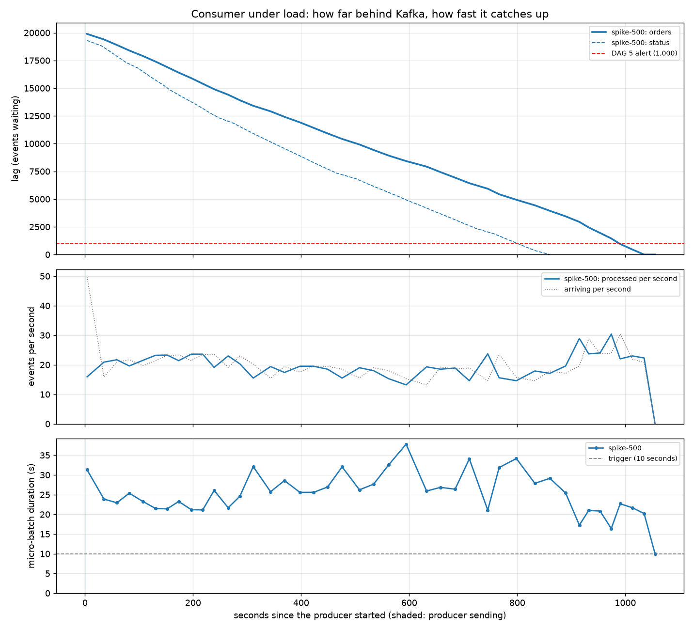

# Performance: spike-500

Generated 2026-11-06 16:26 by `streaming/perf_report.py`.

| metric | spike-500 |
|---|---|
| producer | burst 20000 |
| maxOffsetsPerTrigger | 500 |
| events sent | 20,389 |
| send time (s) | 1 |
| send rate (ev/s) | 17,948 |
| peak lag | 19,891 |
| peak at (s) | 4 |
| back to real time (s) | 1,035 |
| catch-up throughput (ev/s) | 19.3 |
| batch duration median (s) | 25.5 |
| batch duration p95 (s) | 32.5 |
| time above DAG 5 alert (s) | 987 |
| consumer restarts | 0 |

How to read it:
- **peak lag**: the most events waiting in Kafka at one time (the queue at its longest).
- **back to real time**: seconds from the first event sent until the lag was 0 again.
- **catch-up throughput**: events the consumer processed per second while it had a backlog: its real capacity.
- **time above DAG 5 alert**: how long `check_lag` would have been red.
- **batch duration** above the trigger line means each micro-batch takes longer than the trigger interval: the consumer runs batch after batch without pausing.
